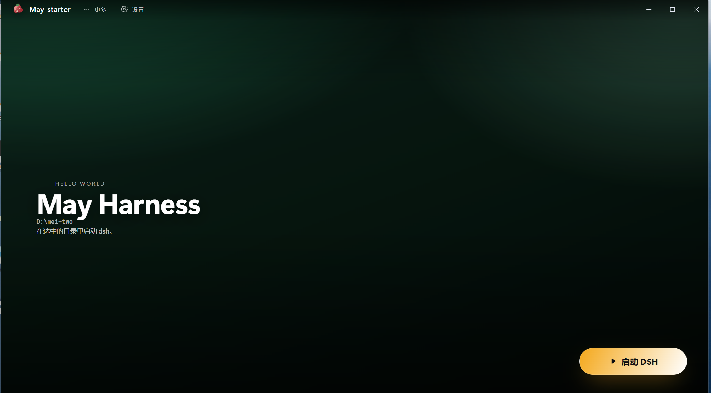
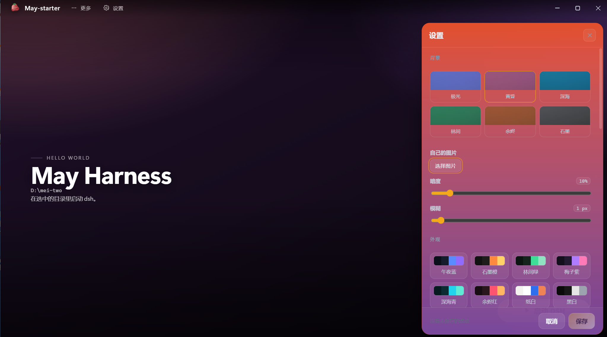
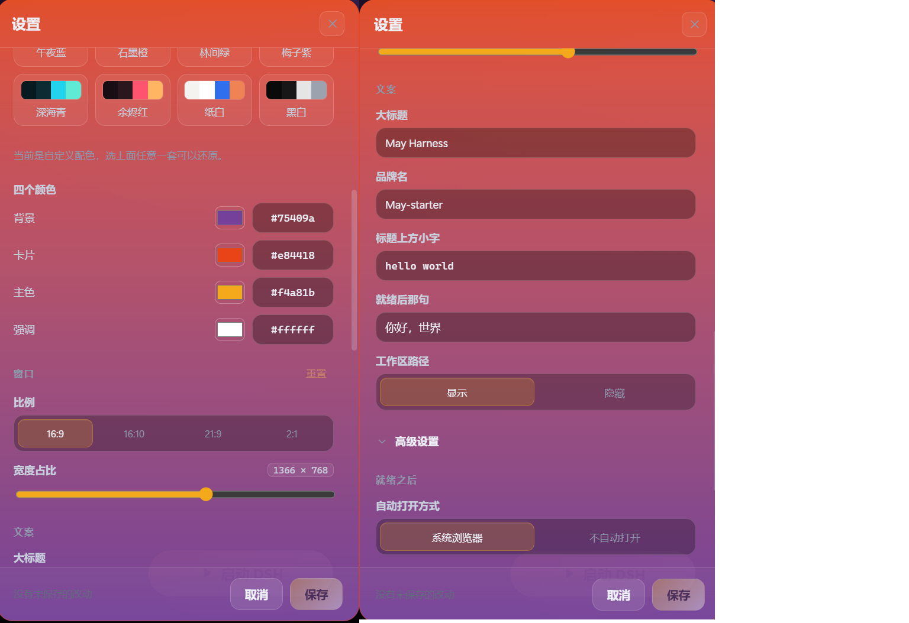

# DSH-starter

> A modern launcher for DeepSeek Harness (`dsh`) — a game-launcher style front door: pick a workspace, watch the boot log, press one button.

**English** · [简体中文](README.md)

[](https://github.com/May447/DSH-starter/releases/latest)
[](https://github.com/May447/DSH-starter/releases)
[](LICENSE)

DSH-starter is a **front door + process supervisor**, not another agent runtime. It does four things:

- **Workspace cards**: keep your usual project folders in the launcher, pick one as the `cwd`
- **One-click launch**: `spawn` a `dsh <profile>` child process and stream its stdout/stderr into the log drawer
- **Ready detection**: parse the `dsh web: http://…` line and hand the DSH Web GUI over to you (system browser)
- **Configurable, nothing hard-coded**: command, profile, extra args, environment, `DSH_HOME`, port

Chat, sessions, approvals and plugins all come from DSH itself — this project does not rebuild them.

---

## Screenshots

Main window — a full-bleed wallpaper, tools top-left, one action bottom-right:



Settings — wallpaper and theme (6 built-in gradients + 8 four-colour themes, or drop in your own art):



Settings — window ratio and copy (16:9 / 16:10 / 21:9 / 2:1; brand name, headline are all editable):



---

## Status

v0.1. Working: Electron + React + electron-vite project, IPC contract, settings persistence, `dsh` child-process lifecycle (including ready-line parsing), the HoYoPlay-style shell, the xterm boot log, and packaging for Windows / macOS / Linux.

## Install (no toolchain needed)

Grab a build from [Releases](https://github.com/May447/DSH-starter/releases/latest) (current: **v0.1.0**; the version in each filename changes with the release):

| Artifact | Use |
| --- | --- |
| `DSH-starter-Setup-0.1.0.exe` | Normal install: pick a path, get desktop / start-menu shortcuts |
| `DSH-starter-0.1.0-portable.exe` | Single-file portable build, no install |
| `.dmg` / `.AppImage` | macOS / Linux |

A working `dsh` is still required (on `PATH`, or an absolute path in Settings). **The launcher does not bundle dsh.**

## Requirements

- Node.js ≥ 22 (verified on 24)
- pnpm ≥ 10
- A working `dsh` on your machine (on `PATH`, or set an absolute path in Settings)

## Quick start

```bash
pnpm install
pnpm dev
```

Defaults: `dshCommand=dsh`, `profile=web`, `port=0` (let the OS pick a free port), `openOnReady=external`.

If `dsh` is not found on the first run, open Settings and point it at the absolute path (on Windows that can be a `dsh.cmd`).

## Configuration

The settings file lives in Electron's `userData` directory:

| Platform | Location |
| --- | --- |
| Windows | `%APPDATA%\DSH-starter\settings.json` |
| macOS | `~/Library/Application Support/DSH-starter/settings.json` |
| Linux | `~/.config/DSH-starter/settings.json` |

Key fields:

```jsonc
{
  "dshCommand": "dsh",              // executable name or absolute path
  "profile": "web",                 // dsh <profile>
  "extraArgs": [],                  // inserted before the launcher's own flags
  "env": { "DSH_HOME": "~/.dsh" },  // extra environment for the child
  "port": 0,                        // 0 = OS-assigned
  "openOnReady": "external",        // external | none
  "theme": {                        // four slots; everything else is derived
    "preset": "midnight",
    "background": "#0b0f1a",
    "surface": "#151c2c",
    "primary": "#5b8cff",
    "accent": "#8f6bff"
  },
  "background": {                   // main-screen backdrop
    "preset": "aurora",             // built-in gradient id
    "imagePath": null,              // absolute path to your own picture
    "dim": 0.35,
    "blur": 0
  },
  "workspaces": [{ "id": "…", "name": "…", "path": "…" }]
}
```

Two environment variables help with development and CI:

- `DSH_STARTER_USER_DATA=<dir>` — use this directory as `userData` (sandbox-friendly, keeps your real settings untouched)
- `--capture <file>` — render one frame to PNG and exit, for visual smoke tests

## Development

```bash
pnpm install
pnpm dev        # electron-vite with hot reload
pnpm typecheck  # main + renderer type check
pnpm build      # build into out/
```

If `pnpm run <script>` trips over the dependency pre-check (the embedded `pnpm install` inside electron-builder is a known source of `ERR_PNPM_UNEXPECTED_STORE`), call the tools directly:

```bash
node node_modules/electron-vite/bin/electron-vite.js dev --noSandbox
node node_modules/electron-vite/bin/electron-vite.js build
```

### Three environment traps

1. **Chromium sandbox vs. leftover ACLs**: if the project directory has been used as a workspace by DSH or a similar tool, extra permission entries can stop Chromium's sandbox from starting (`electron --version` exits with `0x80000003`). Use `--noSandbox` for dev and `--no-sandbox` for manual runs and smoke tests. Normal user directories are unaffected, and packaged builds do not need the flag.
2. **Duplicate proxy variables**: Windows allows both `HTTP_PROXY` and `http_proxy`; some shells then refuse to spawn a child (`已添加项。字典中的关键字…`). Clear the lowercase variants before launching.
3. **`ELECTRON_RUN_AS_NODE`**: if your shell exports it, `electron.exe` starts as plain Node and the app dies on `electron.app` being undefined. Unset it for the run.

### Headless smoke test

```powershell
powershell -NoProfile -ExecutionPolicy Bypass -File scripts\smoke.ps1 -Out .dev-shots\smoke
# -UserData <dir>   point at another settings directory
# -NoAutostart      capture the idle stage (empty-state check)
# -Ui settings,advanced   click [data-action] controls before capturing
# -Ui more,log            open the log drawer from the "more" menu
# -Ui settings,copysec    scroll the drawer to the copy section
# -WindowCapture          also save <Out>-window.png (native window buttons included)
```

It launches the app detached, waits for the screenshot, then reaps any `dsh` orphans. `--capture <png>` writes a frame, `--dump-dom <txt>` writes `body.innerText`, `--capture-delay <ms>` adds settle time, and `--capture-window <png>` grabs the composited window (`capturePage` cannot see the OS window-controls strip).

A real launch needs a working `dsh`. For local development `.dev\dsh-web-test.cmd` points `DSH_HOME` at the checkout and runs the CLI from there; set `dshCommand` to that file.

## Architecture

```
src/
  main/       Electron main: window, IPC, dsh child lifecycle, settings store
  preload/    contextBridge surface (the only API the renderer sees)
  renderer/   React launcher UI (wallpaper shell, glass panels)
  shared/     IPC contract and defaults shared by all three
```

Design notes and decisions: [docs/DESIGN.md](docs/DESIGN.md). Hand-over notes (traps, known issues, next steps): [docs/HANDOVER.md](docs/HANDOVER.md).

## Packaging

```bash
pnpm run pack:dir # unpacked directory: release/win-unpacked/DSH-starter.exe
pnpm run dist     # installer for the current platform (NSIS on Windows)
```

`electron-builder.yml` is set up for Windows NSIS (custom install dir, desktop shortcut), macOS dmg and Linux AppImage, with `asar` packaging and only `en-US` / `zh-CN` locales.

Size reference (Windows x64, Electron 45): the unpacked directory is ~310 MB (most of it is `DSH-starter.exe`, i.e. Chromium); the installer is ~110 MB compressed. That is the inherent cost of Electron.

> **Output path must be ASCII.** NSIS fails when the build output or the portable directory sits under a non-ASCII path.

## Roadmap

- [x] M0 project skeleton + IPC contract
- [x] M1 launcher UI + boot log terminal (xterm.js)
- [x] M2 real `dsh web` launch → ready detection → hand-over
- [x] M3 interactive terminal (reuse the DSH Web GUI sidebar terminal, no custom pty)
- [x] M4 packaging (electron-builder: Windows / macOS / Linux)
- [x] M5 English README
- [ ] i18n for the UI strings
- [ ] First-run onboarding tour

### What v0.1 does

- **Full-bleed wallpaper shell**: six built-in gradients or your own picture (file dialog or drag-and-drop); dim and blur apply live while dragging, and the native window buttons sit on a transparent strip
- **Mirrored, game-launcher layout**: utilities top-left (brand, more, settings), the single action bottom-right (one button: launch / cancel / stop), and only the workspace name in the middle
- **The Web GUI lives in the "more" menu**: ready state, masked URL, open, copy and the boot log — the first screen never repeats a button
- **Empty state that teaches**: three short steps and a "pick a folder" action when no workspace exists
- Runs `dsh` as a hidden background child (no console window); on ready it opens **only in your system browser**
- Four-colour theme (background / surface / primary / accent): eight presets plus custom, applied **only to the launch button and the settings panel**, with text contrast derived automatically
- **Highly customisable**: window aspect ratio (16:9 / 16:10 / 21:9 / 2:1) and its share of the work area apply live, and the headline, brand name, kicker line, ready sentence and path visibility are all editable (Settings → 文案; an empty headline falls back to the workspace name), and workspaces can be renamed in place; the panel also carries backdrop / palette / open-on-ready / font size / advanced (command, profile, port, args, env)
- Interactive terminal stays in the DSH Web GUI sidebar; packaging via electron-builder (NSIS/dmg/AppImage)

Known gaps: UI strings are Chinese-only (no i18n); no first-run tour; builds are unsigned.

## Security

- **It runs the command you configure** — that is the feature, and it also means a tampered `settings.json` is arbitrary code execution. Threat model: [SECURITY.md](SECURITY.md).
- No network access of its own, no telemetry, no update pings. The Web GUI `?token=…` is always masked, copying goes through the system clipboard, and only http/https URLs are handed to the browser.
- Renderer runs with `contextIsolation` + `sandbox` + CSP; new windows are denied, navigation and webviews are blocked, permission requests are refused.
- Please report vulnerabilities privately (repo **Security → Advisories**).

## Contributing

See [CONTRIBUTING.md](CONTRIBUTING.md) for the environment, the smoke script, and the pre-commit checklist.

## License

MIT — see [LICENSE](LICENSE).
